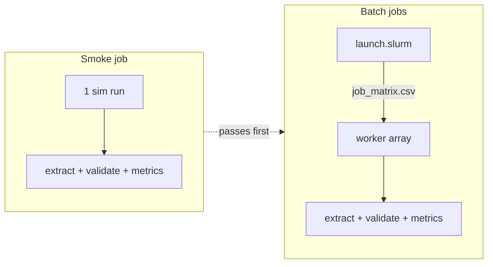

# DASH trace extraction pipeline

This document describes how to run ns-3 QUIC-DASH simulations on a Slurm cluster, extract per-decision ABR traces, and validate outputs for LLM ABR training. The pipeline is **algorithm-agnostic**: the same scripts work for `ns3::FdashClient`, `ns3::AiDashClient`, and other DASH clients supported by `ntn-iab-quic-dash-ai`.

## Overview




| Stage                 | Slurm script                      | Purpose                                                                                    |
| --------------------- | --------------------------------- | ------------------------------------------------------------------------------------------ |
| **Smoke**             | `dash_trace_smoke.slurm`          | One end-to-end run to verify build, paths, metadata, and Python tools before a large batch |
| **Launch**            | `dash_trace_launch.slurm`         | Discover metadata CSVs, write `job_matrix.csv`, submit worker array                        |
| **Worker**            | `dash_trace_worker.slurm`         | One simulation + trace extraction per array task (not submitted directly)                  |
| **Training traces**   | `extract_traces.slurm`            | Batch re-extract `trace_decisions.jsonl` from existing `sim.log` (no re-sim)               |
| **Throughput traces** | `extract_throughput_traces.slurm` | Batch extract `throughput_trace.jsonl` for DP oracle                                       |
| **Oracle**            | `dp_oracle.slurm`                 | Build `oracle_labels_state.jsonl` per video                                                |


Deprecated aliases `fdash_trace_*.slurm` forward to the `dash_trace_`* scripts with the same behavior.

## Prerequisites

1. **Built simulator** (debug build is typical on this project):
  ```bash
   cd /path/to/ns3-ntn-iab
   python3 ./waf configure --enable-examples
   python3 ./waf build
  ```
2. **Metadata CSVs** — one file per video, named `*_segments.csv`, with `size_bytes_`* columns for the 6-rung ladder (see `scratch/ai_llm/paths.py` / `metadata_loader.py`). Default directory:
  ```text
   /project/6030214/adeel/abr/output/metadata/
  ```
   **4K requirement:** ABR sources must have **long edge ≥ 2160** so `size_bytes_12000k` is real encoded data, not a padded copy of a lower rung. Do not use metadata from pre–4K-catalog batch runs.
   To build metadata for **many videos**:

  | Step      | Where            | Command                                                |
  | --------- | ---------------- | ------------------------------------------------------ |
  | Download  | `abr/` repo root | `FORCE_DOWNLOAD=1 sbatch download_videos_launch.slurm` |
  | Audit     | `abr/scripts/`   | `python3 scripts/audit_video_resolution.py`            |
  | ABR batch | `abr/` repo root | `sbatch run_batch_launch.slurm`                        |

   Docs: **[plan-multi-video-catalog-pipeline.md](plan-multi-video-catalog-pipeline.md)**, `**../abr/docs/multi-video-pipeline-operations.md`**, `**../abr/docs/README.md**`.
   After the ABR batch completes:
3. **Slurm account** — scripts default to `#SBATCH --account=def-ekram`. Edit the `#SBATCH` lines if your account differs.
4. **Unix line endings** — Slurm rejects CRLF (`\r\n`) in batch scripts. If `sbatch` reports DOS line breaks:
  ```bash
   sed -i 's/\r$//' dash_trace_*.slurm extract_traces.slurm extract_throughput_traces.slurm dp_oracle.slurm scratch/ai_llm/algo_paths.sh
  ```
   Repository `.gitattributes` keeps `*.slurm` and `*.sh` as LF on checkout.

## Smoke test vs batch

### Smoke (`dash_trace_smoke.slurm`)

Use the smoke job when you want to **debug the full pipeline on one run** without paying for an array of workers.

It:

- Runs **one** simulation (default: `hiking_segments.csv`, `run_1`, `ns3::FdashClient`)
- **Short by default:** ~15 s of DASH content (`MAX_VIDEO_DURATION=15`) and ~18 s simulation wall clock (`SIM_STOP_TIME` auto = duration + 3 s)
- Writes artifacts under a single `RUN_DIR`
- Runs `extract_trace.py`, `validate_extracted_trace.py` (strict — failure fails the job), and `compute_run_metrics.py`

Submit:

```bash
sbatch dash_trace_smoke.slurm

# strict 15 s sim only (no segment cap from metadata):
MAX_VIDEO_DURATION=0 SIM_STOP_TIME=15 sbatch dash_trace_smoke.slurm

# longer smoke (full metadata, 90 s sim — requires rebuild after pulling):
MAX_VIDEO_DURATION=0 SIM_STOP_TIME=90 sbatch dash_trace_smoke.slurm
```

Smoke passes `--simStopTime` and optional `--maxVideoDuration` to `ntn-iab-quic-dash-ai` (rebuild with `python3 waf build` after pulling C++ changes). Batch workers are unchanged (full-length runs).

Logs: `dash_trace_smoke_<jobid>.out` / `.err` in the repo root (where you run `sbatch`).

### Batch (`dash_trace_launch.slurm` + workers)

Use the launcher when you need **many runs** — every combination of discovered metadata file × run seed.

The launcher:

1. Calls `scratch/ai_llm/build_job_matrix.py` to write `Quic_artifacts/job_matrix/job_matrix_<timestamp>.csv`
2. Runs `waf build` once, then submits `dash_trace_worker.slurm` as a Slurm array (`1-N` or `1-N%MAX_PARALLEL`)

Each worker performs the same post-processing as smoke; validation uses `|| true` so a bad trace does not kill the whole array (check logs per task).

Example:

```bash
export METADATA_DIR=/project/6030214/adeel/abr/output/metadata
export RUNS_PER_METADATA=3 MAX_VIDEOS=0
# Default MAX_PARALLEL=0 → all array tasks at once (no Slurm % cap)
sbatch dash_trace_launch.slurm

# Optional throttle if the cluster is busy:
# MAX_PARALLEL=10 sbatch dash_trace_launch.slurm
```

**Recommended workflow:** smoke passes → launch batch.

## Artifact layout

Runs use the **run directory as cwd** so relative trace files (e.g. `dash_metadata_segments.csv`) land next to the sim.

```text
Quic_artifacts/
  job_matrix/
    job_matrix_20260523_194631.csv
  <AlgoShort>/          # e.g. Fdash, AiDash (from ns3::XxxClient)
    <video>/            # e.g. hiking
      run_<seed>/
        run_manifest.json
        sim.log
        dash_metadata_segments.csv   # server metadata audit trace
        trace_decisions.jsonl        # extracted training records
        run_metrics.json
        user_metrics.csv
        … ns-3 ascii traces …
```


| Path component | Meaning                                                           |
| -------------- | ----------------------------------------------------------------- |
| `AlgoShort`    | `ns3::FdashClient` → `Fdash` (see `scratch/ai_llm/algo_paths.sh`) |
| `run_<seed>`   | `--run` RNG / scenario seed                                       |


`--numRelay` still configures the ns-3 topology but is **not** part of the artifact path (fixed single-relay setup).

For TCP experiments, set `PROTOCOL=TCP` to use `Tcp_artifacts/` instead of `Quic_artifacts/`.

## Environment variables

### Smoke and launch


| Variable             | Default                    | Description                                                                                           |
| -------------------- | -------------------------- | ----------------------------------------------------------------------------------------------------- |
| `NS3_REPO`           | repo root                  | Path to this ns-3 tree                                                                                |
| `METADATA_CSV`       | `…/hiking_segments.csv`    | **Smoke only** — single metadata file                                                                 |
| `METADATA_DIR`       | `…/abr/output/metadata`    | **Launch only** — directory to scan                                                                   |
| `ALGORITHM`          | `ns3::FdashClient`         | ns-3 DASH client type name                                                                            |
| `PROTOCOL`           | `QUIC`                     | `QUIC` or `TCP` (artifact root)                                                                       |
| `AI_ENABLE`          | `false`                    | `true` for ns3-ai shared-memory ABR (requires Python driver)                                          |
| `NUM_RELAY`          | `1` (smoke), `1` (launch)  | Relay count                                                                                           |
| `NUM_UES`            | `1` (smoke), `10` (launch) | UE count                                                                                              |
| `RUN_SEED`           | `1`                        | **Smoke only** — `--run` seed                                                                         |
| `MAX_VIDEO_DURATION` | `15`                       | **Smoke only** — cap segment requests (`0` = full metadata CSV)                                       |
| `SIM_STOP_TIME`      | `0` (auto)                 | **Smoke only** — `Simulator::Stop` seconds (`0` → `MAX_VIDEO_DURATION+3`, or `90` if duration is `0`) |


### Launch only


| Variable            | Default          | Description                                                                              |
| ------------------- | ---------------- | ---------------------------------------------------------------------------------------- |
| `RUNS_PER_METADATA` | `5`              | Runs per video (seeds `RUN_OFFSET` … `RUN_OFFSET+N-1`)                                   |
| `RUN_OFFSET`        | `1`              | First run seed                                                                           |
| `MAX_VIDEOS`        | `0`              | Cap videos (`0` = all matching files)                                                    |
| `VIDEO_GLOB`        | `*_segments.csv` | Glob under `METADATA_DIR`                                                                |
| `MAX_PARALLEL`      | `0`              | Slurm array throttle: `0` = all parallel (`1-N`); `N>0` = at most N concurrent (`1-N%N`) |


### Worker (set by launcher)


| Variable     | Description                                |
| ------------ | ------------------------------------------ |
| `JOB_MATRIX` | Absolute path to CSV written by launch job |


Example — smoke with AI-DASH and more UEs:

```bash
export ALGORITHM=ns3::AiDashClient AI_ENABLE=true NUM_UES=5
sbatch dash_trace_smoke.slurm
```

## What each job runs

### Simulation

Binary: `build/scratch/ntn-iab-quic-dash-ai`

Important flags (set by Slurm scripts):


| Flag                     | Role                                                                               |
| ------------------------ | ---------------------------------------------------------------------------------- |
| `--algorithm`            | ABR client (`ns3::FdashClient`, etc.)                                              |
| `--dashMetadataCsv`      | Input segment sizes                                                                |
| `--dashMetadataTrace`    | Output audit log (`dash_metadata_segments.csv` in run dir)                         |
| `--run`                  | Run seed                                                                           |
| `--numRelay`, `--numUes` | Topology                                                                           |
| `--aiEnable`             | ns3-ai IPC on/off                                                                  |
| `--simStopTime`          | Simulation stop time (seconds); batch workers auto-set from segment count if unset |
| `--maxVideoDuration`     | Cap playback segments from metadata (`0` = full CSV)                               |


**Sim duration vs catalog:** ABR metadata uses **2 s/segment** (catalog clips ≤ **120 s**). ns-3 DASH uses **~3.3 s/segment** (100×33 ms MPEG frames). Longest CSVs have **60 segments** → need **~200–270 s** simulated time for full playback; the old fixed **90 s** truncated long videos. Workers now set `simStopTime ≈ 4×N_segments+30` (clamped 90–600 s).

**Slurm worker wall time (`#SBATCH --time=08:00:00`):** Enough for pre-built binary + up to **600 s** simulated time + **10 UEs** + trace I/O. Smoke with 1 UE / 18 s sim used ~20+ min elapsed (mostly build/queue); batch launcher runs `waf build` once first.

Workers call `waf build` only on **array task 1** to avoid concurrent builds. Smoke always builds.

### Runtime library path

The scratch binary links against ns-3 modules in `build/` (e.g. `libns3.27-dash-debug.so`). Slurm scripts call `export_ns3_runtime` from `algo_paths.sh`, which sets:

```bash
export LD_LIBRARY_PATH="${NS3_REPO}/build:${LD_LIBRARY_PATH}"
```

Without this, the sim exits immediately with “cannot open shared object file” even when `waf build` succeeds.

### Post-processing (Python)


| Tool                                    | Output                                                                                                                |
| --------------------------------------- | --------------------------------------------------------------------------------------------------------------------- |
| `scratch/ai_llm/extract_trace.py`       | `trace_decisions.jsonl` — per-decision records with `model_input` and teacher labels from sim log + metadata          |
| `scripts/extract_throughput_traces.py`  | `throughput_trace.jsonl` — per-segment transport metrics keyed by `(run_id, node_id, segment_id)` for oracle pipeline |
| `scripts/validate_extracted_trace.py`   | Checks ladder bitrates, segment indices, metadata consistency                                                         |
| `scratch/ai_llm/compute_run_metrics.py` | `run_metrics.json`, `user_metrics.csv`                                                                                |


Manual extraction (single run):

```bash
python3 scratch/ai_llm/extract_trace.py \
  --run-dir Quic_artifacts/Fdash/hiking/run_1 \
  --metadata /path/to/hiking_segments.csv \
  --output Quic_artifacts/Fdash/hiking/run_1/trace_decisions.jsonl \
  --run-id run_1
```

#### Batch re-extract (`extract_traces.slurm`)

Workers call `extract_trace.py` after each sim, but with `set -e` a parser crash **fails the worker** while leaving a valid `sim.log`. Use this Slurm wrapper to refresh `**trace_decisions.jsonl` for the whole catalog** without re-simulating (e.g. after updating `extract_trace.py` or recovering from worker `.err` tracebacks).

```bash
export METADATA_DIR=/project/6030214/adeel/abr/output/metadata
sbatch extract_traces.slurm

# optional
VIDEO=hiking WORKERS=8 STRICT=0 sbatch extract_traces.slurm
```

Same batch mode without Slurm:

```bash
python3 scratch/ai_llm/extract_trace.py \
  --artifacts-root Quic_artifacts \
  --algo-short Fdash \
  --metadata-dir "$METADATA_DIR" \
  --workers 8 \
  --strict
```

Logs: `extract_traces_<jobid>.out` / `.err` in the repo root.

**Not the same as** `extract_throughput_traces.slurm` — that script writes `throughput_trace.jsonl` for the DP oracle, not training decision records.

### Throughput traces (Phase C — oracle labels)

`extract_throughput_traces.py` is **parallel** to `extract_trace.py`: it does not change `trace_decisions.jsonl` or training labels from FDASH decisions. It emits raw transport rows for downstream collapse and DP oracle labeling.

**Per-row keys:** `(run_id, node_id, segment_id)` — used to join seeds and aggregate; not causal model features.

**Metrics (v1):**


| Field                  | Source                                                                                               |
| ---------------------- | ---------------------------------------------------------------------------------------------------- |
| `segment_bytes`        | Sum of Rx frame sizes for frames `[segment_id×100, (segment_id+1)×100)`                              |
| `segment_fetch_time_s` | Δ between consecutive decision completion times (`sim_time_s`); segment 0 uses first Tx/Rx timestamp |
| `throughput_bps`       | `8 × segment_bytes / segment_fetch_time_s`                                                           |


Schema constants: `scratch/ai_llm/trace_schema.py` (`THROUGHPUT_TRACE_REQUIRED_FIELDS`, MPEG timing).

Single run (after sim or batch worker):

```bash
RUN=Quic_artifacts/Fdash/hiking/run_1
python3 scripts/extract_throughput_traces.py \
  --run-dir "$RUN" \
  --strict \
  --include-estimate

# Default output: $RUN/throughput_trace.jsonl
# Row count should match parsed ABR decisions in sim.log
wc -l "$RUN/throughput_trace.jsonl"
```

Batch over artifact tree (Slurm):

```bash
export METADATA_DIR=/project/6030214/adeel/abr/output/metadata
sbatch extract_throughput_traces.slurm
```

Or interactively:

```bash
python3 scripts/extract_throughput_traces.py \
  --artifacts-root Quic_artifacts \
  --algo-short Fdash \
  --video hiking \
  --run-glob 'run_*' \
  --metadata-dir "$METADATA_DIR" \
  --workers 4
```

**Modes:** default skips rows with missing Rx bytes or invalid throughput; `--strict` fails the run instead.

**Next steps (not in this script):** `scripts/aggregate_traces.py` (median/std per `(video_name, segment_id)` across seeds) → `scripts/dp_oracle.py` (semantic backward-DP per `(run_id, node_id, segment_id)`, see [DP oracle labels](#dp-oracle-labels-phase-c--supervised-targets)) → `dataset_builder.py` with `--teacher-source oracle`.

### Aggregate throughput traces (Phase C — per-video segment profiles)

After you have `throughput_trace.jsonl` under each `run_`*, collapse them into a single per-video summary:

```bash
export METADATA_DIR=/project/6030214/adeel/abr/output/metadata

# Per-video: Quic_artifacts/Fdash/<video>/aggregated_throughput.jsonl
python3 scripts/aggregate_traces.py \
  --artifacts-root Quic_artifacts \
  --algo-short Fdash \
  --video hiking \
  --run-glob 'run_*' \
  --metadata-dir "$METADATA_DIR" \
  --strict
```

Output rows are keyed by `(video_name, segment_id)` and include pooled `median/std` (plus conservative min/max hints) across all `run_id` and all `node_id`. `scripts/dp_oracle.py` reads per-run `throughput_trace.jsonl` directly; aggregated profiles are optional for diagnostics.

### DP oracle labels (Phase C — supervised targets)

`scripts/dp_oracle.py` runs a **semantic backward-DP oracle** over per-(run, node) throughput trajectories and writes `**oracle_labels_state.jsonl`** keyed by `(run_id, node_id, segment_id)`.

**Inputs**


| File                                                         | Role                                                                                                                                      |
| ------------------------------------------------------------ | ----------------------------------------------------------------------------------------------------------------------------------------- |
| `Quic_artifacts/<algo>/<video>/run_*/throughput_trace.jsonl` | Replayed per-(run, node) throughput trajectory                                                                                            |
| `<METADATA_DIR>/<video>_segments.csv`                        | Per-rung `size_bytes_*` and `vmaf_*`, plus semantic features (`saliency_score`, `object_score`, `quality_sensitivity`, `scene_cut_count`) |
| `scratch/ai_llm/config/oracle_reward.json`                   | Reward weights, player model, and DP knobs (override with `--reward-config`)                                                              |


**Per-segment semantic reward**

For each segment t and chosen rung a_t:


w_t = 0.5\cdot \widetilde{qs}_t + 0.3\cdot \widetilde{sal}_t + 0.2\cdot \widetilde{obj}_t


\text{cutdiscount}_t = 0.6 \cdot \mathbb{1}[\text{scenecutcount}_t > 0]


\text{switchpenalty}*t = w*{\text{switch}}\cdot \lvert q_t(a_t) - q_{t-1}(a_{t-1})\rvert \cdot (1 - \text{cutdiscount}_t)


R_t = w_{\text{vmaf}}\cdot w_t\cdot q_t(a_t) - w_{\text{stall}}\cdot \text{stall}_t - \text{switchpenalty}_t


`~` denotes min-max normalization across the video's segments. `q_t(a_t)` is the per-rung VMAF from metadata. The default weights live in `oracle_reward.json` (`w_vmaf=1.0`, `w_stall=10.0`, `w_switch=0.3`, `scene_cut_discount=0.6`).

**Backward-DP objective (current + future value)**


V_t(s_t) = \max_{a_t} \Bigl( R_t(s_t, a_t) + \gamma \cdot V_{t+1}(s_{t+1}) \Bigr), \quad V_T(s_T) = 0


The oracle label for state s_t is a_t^* = \arg\max. The implementation uses an equivalent forward DP with backpointers (deterministic transitions ⇒ same optimum) for clarity.

**State and transition model**

- `prev_rung ∈ {0..5}`
- `buffer_bin` quantized in `buffer_bin_size_s` (default 0.5 s) up to `max_buffer_s` (default 30 s)
- `playing ∈ {0, 1}` — startup vs. active playback
- Startup: no stall; accumulate buffer until `startup_threshold_s` (default 10 s), then flip `playing=1`.
- Playback: `stall = max(0, download_time_s − buffer_before)`, `buffer_after = min(MAX_BUFFER, max(0, buffer_before − download_time_s) + SEGMENT_DURATION)`.
- `download_time_s = 8 × size_bytes[t][r] / throughput_bps[t]`, where `throughput_bps[t]` is the **per-(run,node)** value from `throughput_trace.jsonl` (so the same video produces different labels for different sessions).

**Output: `oracle_labels_state.jsonl`** — one row per `(run_id, node_id, segment_id)` with the optimal action plus DP diagnostics:


| Field                                                                  | Meaning                                            |
| ---------------------------------------------------------------------- | -------------------------------------------------- |
| `oracle_bitrate_idx`, `oracle_bitrate_bps`                             | Optimal action on the 6-rung ladder                |
| `immediate_reward`, `future_value`, `total_q_value`                    | Decomposition of R_t + V_{t+1} on the optimal path |
| `buffer_before_s`, `buffer_after_s`, `playing_before`, `playing_after` | Replay state at the decision point                 |
| `predicted_download_time_s`, `predicted_rebuffer_s`, `switch_penalty`  | Transition diagnostics                             |
| `semantic_weight`, `is_scene_cut`, `vmaf_chosen`, `vmaf_prev`          | Reward inputs for that step                        |
| `throughput_bps`, `throughput_source`                                  | Throughput consumed by the transition model        |
| `session_total_qoe`, `session_segment_count`                           | Session-level rollup                               |
| `oracle_policy`, `reward_config`                                       | Provenance                                         |


Required field lists: `ORACLE_LABELS_STATE_REQUIRED_FIELDS` in `[scratch/ai_llm/trace_schema.py](../scratch/ai_llm/trace_schema.py)`.

Per-video run:

```bash
python3 scripts/dp_oracle.py \
  --artifacts-root Quic_artifacts \
  --algo-short Fdash \
  --video hiking \
  --metadata-dir "$METADATA_DIR" \
  --reward-config scratch/ai_llm/config/oracle_reward.json \
  --strict

# Default output: Quic_artifacts/Fdash/hiking/oracle_labels_state.jsonl
```

Catalog-wide (parallel per video):

```bash
python3 scripts/dp_oracle.py \
  --artifacts-root Quic_artifacts \
  --algo-short Fdash \
  --metadata-dir "$METADATA_DIR" \
  --workers 8
```

#### Slurm (`dp_oracle.slurm`)

Wraps the catalog-wide invocation with the same `algo_paths.sh` helpers as `extract_throughput_traces.slurm`. Run after `throughput_trace.jsonl` exists under each `run_*`.

```bash
export METADATA_DIR=/project/6030214/adeel/abr/output/metadata

# Full catalog (Fdash, QUIC)
sbatch dp_oracle.slurm

# Single-video rerun
VIDEO=hiking sbatch dp_oracle.slurm
```


| Env var         | Default                                    | Maps to CLI                              |
| --------------- | ------------------------------------------ | ---------------------------------------- |
| `METADATA_DIR`  | `…/metadata`                               | `--metadata-dir`                         |
| `PROTOCOL`      | `QUIC`                                     | `Quic_artifacts` vs `Tcp_artifacts`      |
| `ALGO_SHORT`    | `Fdash`                                    | `--algo-short`                           |
| `WORKERS`       | `${SLURM_CPUS_PER_TASK:-8}`                | `--workers`                              |
| `STRICT`        | `1`                                        | `--strict` when `1`                      |
| `VIDEO`         | empty                                      | `--video <name>` for single-video reruns |
| `REWARD_CONFIG` | `scratch/ai_llm/config/oracle_reward.json` | `--reward-config`                        |
| `RUN_GLOB`      | `run_*`                                    | `--run-glob`                             |


Logs land in `dp_oracle_<jobid>.out` / `.err` at the repo root.

#### Validation

`scripts/test_dp_oracle.py` runs in seconds and covers:

- DP optimality vs brute-force enumeration on a small horizon (fine bin),
- 10%-bound check against brute force with the production 0.5 s bin,
- buffer/rebuffer transition invariants,
- reward and scene-cut-discount equations,
- a fluctuating-throughput rung histogram (DP must use middle rungs, not collapse to extremes),
- presence of every `ORACLE_LABELS_STATE_REQUIRED_FIELDS` field on produced rows.

```bash
python3 scripts/test_dp_oracle.py
```

### Train with oracle labels via `dataset_builder.py`

`scratch/ai_llm/dataset_builder.py` joins `oracle_labels_state.jsonl` onto its per-decision records by `**(run_id, node_id, segment_id)**`. Omit `--teacher-source` and you still get FDASH labels.

> **Schema v2 (raw) — normalize at load.** The builder writes **raw** rows (`observation`, `semantic_raw`, raw `ladder_context`) and does **not** bake `network_norm`/`semantic_norm`. Fit the scalers separately from the raw shards (`scripts/fit_network_scaler.py`, `scripts/fit_semantic_scaler.py`); `train.py` and inference apply them at load via `features.build_model_input_from_row` and pin them in the checkpoint. So the flow is **build once → fit scalers → train** (no second build; changing a scaler is just re-fit + retrain). The builder also writes `train_jsonl/manifest.json` pinning the scalers. Full runbook: [`cluster-rerun-handoff.md`](cluster-rerun-handoff.md).

**Single run:**

```bash
RUN=Quic_artifacts/Fdash/hiking/run_1
META=$METADATA_DIR/hiking_segments.csv

python3 scratch/ai_llm/dataset_builder.py \
  --run-dir "$RUN" \
  --metadata "$META" \
  --output train_jsonl/hiking_run_1.jsonl \
  --run-id run_1 \
  --teacher-source oracle \
  --oracle-labels Quic_artifacts/Fdash/hiking \
  --strict
```

**Catalog batch:**

```bash
python3 scratch/ai_llm/dataset_builder.py \
  --artifacts-root Quic_artifacts \
  --algo-short Fdash \
  --metadata-dir "$METADATA_DIR" \
  --output-dir train_jsonl \
  --teacher-source oracle \
  --strict
```

Diagnostics: the builder prints `Oracle join: attached=<N> missing=<M> (e.g. <sample keys>)`. In `--strict` mode a missing join fails the build with the offending key.

In oracle mode the `teacher` block becomes:


| Field                                                                                                                                                                                                             | Source                                                      |
| ----------------------------------------------------------------------------------------------------------------------------------------------------------------------------------------------------------------- | ----------------------------------------------------------- |
| `name`                                                                                                                                                                                                            | `"dp_oracle"`                                               |
| `chosen_bitrate_bps` / `chosen_bitrate_class`                                                                                                                                                                     | from `oracle_bitrate_bps`                                   |
| `oracle_bitrate_idx`                                                                                                                                                                                              | passthrough                                                 |
| `delay_s`                                                                                                                                                                                                         | `0.0` (delay is dropped from learning per the unified plan) |
| `oracle_policy`, `immediate_reward`, `future_value`, `total_q_value`, `predicted_buffer_*_s`, `predicted_rebuffer_s`, `switch_penalty`, `semantic_weight`, `is_scene_cut`, `vmaf_chosen`, `throughput_bps_replay` | DP diagnostics                                              |


Semantics and `model_input` fields are unchanged — only the teacher target switches.

Build job matrix without Slurm:

```bash
python3 scratch/ai_llm/build_job_matrix.py \
  --metadata-dir /path/to/metadata \
  --output Quic_artifacts/job_matrix/job_matrix_manual.csv \
  --runs-per-metadata 3 --max-videos 2 \
  --algorithm ns3::FdashClient
```

## Job matrix CSV

Columns: `task_id`, `metadata_csv`, `video_name`, `run_seed`, `num_relay`, `num_ues`, `algorithm`

- One row per `(video, run_seed)`.
- Array task `k` reads **line `k+1`** (line 1 is the header).
- Files must use **Unix line endings** (`\n`). CRLF in the matrix breaks path parsing (`FdashClient\r/...`) and empty fields on the last task.

## Metadata: input CSV vs trace file


| File                         | Direction | Purpose                                                                    |
| ---------------------------- | --------- | -------------------------------------------------------------------------- |
| `--dashMetadataCsv`          | Input     | Segment sizes per rung; drives `SendSegment`                               |
| `dash_metadata_segments.csv` | Output    | Audit log: `metadata`, `reject_invalid`, or `synthetic` per served segment |


A healthy run should show `metadata` rows in the trace and no garbage segment IDs in the server log.

## Monitoring and troubleshooting

### Log files


| Job               | stdout                                       | stderr                           |
| ----------------- | -------------------------------------------- | -------------------------------- |
| Smoke             | `dash_trace_smoke_<jobid>.out`               | `dash_trace_smoke_<jobid>.err`   |
| Launch            | `dash_trace_launch_<jobid>.out`              | `dash_trace_launch_<jobid>.err`  |
| Worker            | `dash_trace_worker_<array_jobid>_<task>.out` | `…_err`                          |
| Training traces   | `extract_traces_<jobid>.out`                 | `extract_traces_<jobid>.err`     |
| Throughput traces | `extract_throughput_<jobid>.out`             | `extract_throughput_<jobid>.err` |
| Oracle            | `dp_oracle_<jobid>.out`                      | `dp_oracle_<jobid>.err`          |


```bash
squeue -u "$USER"
tail -f dash_trace_smoke_*.out
```

### Common failures


| Symptom                                             | Likely cause                                                       | Fix                                                                                |
| --------------------------------------------------- | ------------------------------------------------------------------ | ---------------------------------------------------------------------------------- |
| `DOS line breaks` on `sbatch`                       | CRLF in `.slurm`                                                   | `sed -i 's/\r$//' extract_traces.slurm dash_trace_*.slurm …`                       |
| `libns3.*.so: cannot open shared object file`       | Missing `LD_LIBRARY_PATH`                                          | Use current scripts (`export_ns3_runtime`); or `export LD_LIBRARY_PATH=$PWD/build` |
| Worker task 3 empty `video=` / `relay_///`          | CRLF matrix or wrong CSV line                                      | Regenerate matrix; ensure LF; re-submit launch                                     |
| Paths show `FdashClient` not `Fdash`                | `\r` on `algorithm` field                                          | Fix matrix line endings; worker strips `\r` in current scripts                     |
| Sim timeout, tiny `sim.log`                         | Wall time too short or verbose logging                             | Increase `#SBATCH --time`; reduce log level in scenario if needed                  |
| Worker `.err`: `extract_trace.py` traceback, sim OK | Post-proc failed (`set -e`); stale/missing `trace_decisions.jsonl` | Fix extractor; `sbatch extract_traces.slurm` (no re-sim)                           |
| Smoke OK, batch fails validation                    | Stricter smoke vs `                                                |                                                                                    |


### Verify a completed run

```bash
RUN=Quic_artifacts/Fdash/hiking/run_1
test -f "$RUN/trace_decisions.jsonl" && wc -l "$RUN/trace_decisions.jsonl"
test -f "$RUN/run_metrics.json" && head "$RUN/run_metrics.json"
grep -c reject_invalid "$RUN/dash_metadata_segments.csv" || true
```

## Related docs

- [`reduced_dp_oracle_eq.md`](reduced_dp_oracle_eq.md) — reward equations, player model, and the model-input feature contract (network 7-D, semantic 5-D, ladder 6×2).
- [`oracle-rung-selection.md`](oracle-rung-selection.md) — how the reward becomes a chosen rung (greedy vs DP, worked example).

## Related code


| Component                     | Location                                               |
| ----------------------------- | ------------------------------------------------------ |
| Scenario                      | `scratch/ntn-iab-quic-dash-ai.cc`                      |
| Decision log format           | `src/dash/model/dash-client.cc`                        |
| Parser / schema               | `scratch/ai_llm/decision_parser.py`, `trace_schema.py` |
| Slurm helpers                 | `scratch/ai_llm/algo_paths.sh`                         |
| Training dataset (downstream) | `scratch/ai_llm/dataset_builder.py`                    |


Planned extensions (not fully wired in Slurm yet): optional `aggregate_traces.slurm` twin. Batch Slurm wrappers exist for training traces (`extract_traces.slurm`), throughput traces (`extract_throughput_traces.slurm`), and oracle labels (`dp_oracle.slurm`). Training: `scratch/ai_llm/train.py`.

## Quick reference

```bash
# 1. Smoke test (always run first on a new cluster checkout)
sbatch dash_trace_smoke.slurm

# 2. Full batch (all videos × seeds in parallel by default)
export METADATA_DIR=/project/6030214/adeel/abr/output/metadata
export RUNS_PER_METADATA=3 MAX_VIDEOS=0
sbatch dash_trace_launch.slurm

# Small test with throttle:
# RUNS_PER_METADATA=1 MAX_VIDEOS=2 MAX_PARALLEL=2 sbatch dash_trace_launch.slurm

# 3. Post-sim batch (after workers finish — sim.log must exist)
sbatch extract_traces.slurm              # trace_decisions.jsonl
sbatch extract_throughput_traces.slurm     # throughput_trace.jsonl
sbatch dp_oracle.slurm                     # oracle_labels_state.jsonl

# 4. Training JSONL + optional train
python3 scratch/ai_llm/dataset_builder.py \
  --artifacts-root Quic_artifacts --algo-short Fdash \
  --metadata-dir "$METADATA_DIR" --output-dir train_jsonl \
  --teacher-source oracle --strict \
  --merge-output train_jsonl/all_runs.jsonl

# 5. Check logs
ls -lt dash_trace_worker_*.out | head
```

