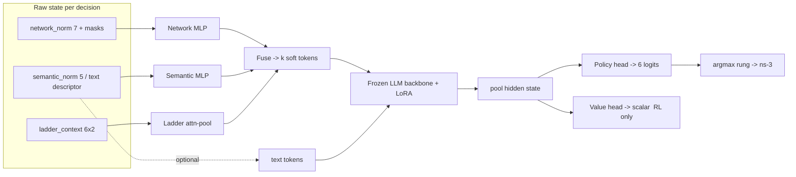

# LLM ABR — end-to-end architecture analysis

An in-depth look at what the model should actually be: the input representation, whether
there's an encoder before the LLM and a head after it, the LLM core itself, and how it all
fits together for training (SFT on the DP oracle, later RL) and for low-latency inference
inside the ns-3 loop.

Grounded in the current contract: `model_input` = `network_norm` (7) + `semantic_norm` (5)
+ `ladder_context` (6×2 `[size_bytes, vmaf]`); label = `oracle_bitrate_idx` ∈ {0..5};
runtime = one decision per segment per UE over the C++ IPC (`AbrDashCpp2PyMsg`).

---

## 1. What kind of problem this is (and why it shapes the architecture)

This is a **small-input, small-output sequential decision** problem:

- **Input is tiny:** 7 + 5 + 12 = 24 scalars per decision. That's a *tabular* state, not a
  long document or an image.
- **Output is a 6-way choice** (the rung), currently learned by **imitation** of a
  QoE-optimal DP oracle (cross-entropy), with **RL against live ns-3 QoE** planned later.
- **Latency-bound:** the policy runs in the ns-3 loop, once per segment per UE, behind an
  IPC. It must be a **single forward pass** — no autoregressive token generation.

Two implications up front:

1. The *decision* itself is low-dimensional, so the **raw numeric state does not, by
   itself, need a 7B-parameter model** — a small MLP/transformer can fit 24→6 well. The
   LLM only earns its place if the **input carries information a small net can't exploit**
   (language/semantic context, world knowledge, cross-content generalization).
2. Therefore the single most important design choice is **the input representation**, not
   the backbone size. Get that right and the rest follows.

## 2. Does this task need an LLM? (honest, tiered)

| Tier | Model | When it's the right call | Cost |
|------|-------|--------------------------|------|
| **0** | Multimodal **encoder + policy head**, no LLM — the `variant="v0"` path (encoder → placeholder `backbone_projector` → head). **Built & trained.** | Input stays the 24 numeric scalars; you want a strong, fast baseline | ~0.1–1 M params, <1 ms/infer |
| **1** | **Small instruct LLM (Qwen2.5-1.5B, H=1536), frozen + LoRA**; encoder → **`SoftTokenProjection`** → soft tokens injected via `inputs_embeds`, optional text semantics, policy head — the `variant="v2"` path. | You enrich the input with **language/semantic context** and want pretrained priors + better OOD generalization | LoRA-trainable; ~5–30 ms/infer GPU |
| **2** | **7B (Qwen2.5-7B, H=3584) + LoRA** | Long natural-language context, multi-signal reasoning, or the thesis explicitly needs a "large" model | 10s of ms/infer; heavy for a per-UE loop |

> Read `H` (LLM hidden size) from the loaded `config.hidden_size`, never hardcode: Qwen2.5-1.5B
> is **1536**, Qwen2.5-7B is **3584** (not 4096). The default backbone is now `Qwen2.5-1.5B-Instruct`.
> The benchmark ladder (`docs/benchmark-plan.md`) splits Tier 1 into **V1** (random-init LLM,
> full-FT — `variant="v1"`) and **V2** (pretrained frozen+LoRA — `variant="v2"`) to isolate
> pretrained knowledge.

**Recommendation:** treat **Tier 0 as the mandatory baseline** (it's almost built), and
make the LLM (Tier 1) **prove it beats Tier 0 on held-out QoE**. If the LLM only ever sees
24 normalized numbers, it will *not* meaningfully beat the MLP — an LLM has no special
advantage on 24 floats. The LLM becomes worth its cost only when you **feed it the semantic
context as language/rich features** (§3). Qwen-7B (Tier 2) is likely over-sized for a
per-segment, per-UE loop; prefer a **0.5–3B** backbone unless latency budget says otherwise.

> Framing for the thesis: "LLM-assisted ABR" is most defensible as *the LLM reasons over
> content semantics expressed in language, fused with numeric network state* — not as "an
> LLM regresses 24 numbers."

## 3. Input design (the crux)

Three options for what the LLM actually consumes:

**(a) Numeric-only soft prompt (weakest LLM justification).** Encode the 24 scalars and
project into the LLM's embedding space as a few "state tokens." Works, but the LLM adds
little over an MLP because no linguistic/world-knowledge signal is present.

**(b) Text-serialized state (pure prompt).** Template the state into text:
`"throughput 4.7 Mbps, buffer 3.0 s, scene: high motion + scene cut, quality-sensitive;
ladder VMAFs [...]; pick a rung 0-5."` Activates language priors, but: numeric precision is
mangled by tokenization, prompts get long (latency), and you fight the model to emit a
clean action. Not ideal as the *only* path.

**(c) Hybrid — numeric encoder → soft tokens, plus a short text semantic descriptor
(recommended).** Keep the **numeric branch exact** (encoder → soft tokens) and add a
**compact natural-language semantic descriptor** as real tokens when it carries information
the 5 scalars can't (content type, scene description, "sports/face/text-heavy", scene-cut
flag). This is the only design where the LLM's pretrained knowledge is doing real work.

**Concrete recommended input:**
- **Numeric:** `network_norm` (7) and `ladder_context` (6×2) → encoder → *k* soft tokens
  (k≈2–4) in LLM hidden space. Numbers stay precise.
- **Semantic:** the 5 `semantic_norm` scalars → encoder → soft token(s) **and/or** a short
  templated phrase from the raw semantic metadata (e.g. `"high motion, scene cut,
  quality-sensitive"`). If you only have the 5 scalars, the soft-token path suffices; if you
  can surface richer per-segment descriptions from the ABR/metadata pipeline, feed them as
  text — that's the LLM's leverage.
- **No history yet** (the oracle label is per-segment and Markovian-ish); add a short
  rung/throughput history as extra tokens later if RL benefits from it.

**Open question to resolve before committing:** *is richer semantic context available* (scene
descriptions, content tags) beyond the 5 numeric scores? If yes → Tier 1 hybrid is clearly
justified. If the 5 scalars are all you'll ever have → Tier 0 is the honest baseline and the
LLM is hard to justify on input grounds alone.

## 4. Encoder *before* the LLM — yes

A lightweight **multimodal encoder** maps the heterogeneous tabular state into a fused
embedding `e_fused [B, 256]`. This exists in `model.py` (`MultimodalEncoder`) and is
**identical across all variants** (v0/v1/v2) — it is *not* changed to target the LLM. What
maps into the LLM's token-embedding space is a **separate** module, `SoftTokenProjection`,
bolted after the encoder. Keeping these two apart is deliberate: it lets v0 reuse the exact
same encoder, keeps the encoder weights comparable across variants, and makes v0 a strict
sub-network.

Spec:

- **Network encoder:** 1D-CNN over the time window (see §12) → `net_emb` (d_net=128).
- **Semantic encoder:** `Linear(5, 64)` → SiLU → LayerNorm → Dropout → `Linear(64,64)` (d_sem=64).
- **Ladder encoder:** per-rung `Linear(2, 32)` over the 6 rungs, then mean-pool (a tiny
  self-attention over rungs is a fair upgrade — it lets the policy compare rungs). d_ladder=32.
- **Fusion:** concat branch embeddings `[B,224]` → `Linear(224, 256)` → `e_fused [B,256]`. This
  is the **shared** encoder output; **v0** feeds it to the placeholder `backbone_projector` → head.
- **Soft-token projection (v1/v2 only, the LLM-embedding step):** `SoftTokenProjection` =
  `Linear(256 → k·H)` → reshape to **`soft_tokens [B,k,H]`**, where `H` = `llm.config.hidden_size`
  (1536 for Qwen2.5-1.5B) and k≈4. These are injected as a prefix via `inputs_embeds=` (no
  `input_ids`), ahead of any future text tokens; the LLM's final-layer hidden state is mean-pooled
  over the k positions → policy head. *This* projection — not the encoder — is what "matches the
  LLM token-embedding space."
- **Sentinel/mask awareness:** RTT/loss are `-1`≈half the time (imputed). The `missing_masks` bits
  are appended to the network vector (7→9 channels) so the model distinguishes "RTT low" from
  "RTT unknown." (Already wired in `features.py` + the loader.)

Design notes: keep it deterministic, no dropout at inference, freeze feature order via
`features.build_model_input` for train/infer parity (already the case).

## 5. The LLM core

- **Backbone:** a **frozen** pretrained instruct model (recommend **0.5–3B**, e.g.
  Qwen2.5-1.5B/3B-Instruct; Qwen2.5-7B only if latency allows). Frozen base + **LoRA/QLoRA**
  adapters — with ~12 K training rows, full fine-tuning of billions of params would overfit
  and waste compute; LoRA is the data-appropriate choice.
- **No autoregression.** Run a **single forward pass** over `[state tokens (+ optional text)]`
  and read a **pooled hidden state** (last token, or attention-pool over the state tokens).
  You are using the transformer as a **contextual encoder**, not a generator.
- **Precision:** QLoRA 4-bit for training; **bf16 or int8** for inference. Optional
  `torch.compile`. Consider **merging** LoRA into the base for deployment and benchmarking
  merged vs adapter latency.
- **Why a frozen LLM helps (if it does):** pretrained priors over the *language* semantic
  descriptors and better generalization to unseen content/network regimes than a small net
  trained on 125 videos. If you never feed language, this benefit largely evaporates (§2).

## 6. Output head *after* the LLM — yes

A small **policy head** on the pooled hidden state:

- **Bitrate head (required):** `Linear(d_model, 256)` → SiLU → Dropout → `Linear(256, 6)`
  → `bitrate_logits`. Action = `argmax` (or top-k constrained). Trained with **cross-entropy**
  vs `oracle_bitrate_idx`; add **class weights** (rung 5 ≈ 51%, rung 1 ≈ 2%).
- **Value head (add for RL):** `Linear(d_model, 1)` → scalar state-value, for actor-critic
  when you move from SFT to RL against ns-3 QoE. Unused during pure SFT.
- **Delay head:** dropped from learning per the current plan (`delay_s` not modeled).
- **Guardrails:** clamp/mask infeasible rungs; on NaN/Inf logits or invalid index, **fall
  back to FDASH** (the C++ client is the final guard). Keep this in `inference.py` /
  `run_ai_dash_llm.py`.

## 7. End-to-end model

Tensor flow (batch B): `network [B,W,9]`, `semantic [B,5]`, `ladder [B,6,2]` → encoder →
`e_fused [B,256]` → `SoftTokenProjection` → `soft_tokens [B,k,H]` → (+ optional `text_emb`) → LLM
(`inputs_embeds=`) → `hidden [B,k(+T),H]` → mean-pool over k → `[B,H]` → head → `logits [B,6]`.
(v0 skips the projection+LLM: `e_fused → backbone_projector → head`.)

**Approximate parameter budget:** encoder + soft-token projection + head ≈ 0.5–3 M trainable
(the head is now `H`-dim for v1/v2, so a bit larger than v0's 256-dim head); LoRA adapters ≈
0.5–2 % of backbone (a few M–tens of M); frozen backbone 1.5 B (not trained). So v2 trains
**single-digit to low-tens of millions** of params — appropriate for 12 K rows. (v1 is the
exception: the random LLM is fully trainable, ~1.5 B params.)

**What changes between Tier 0 and Tier 1:** the encoder (`e_fused [B,256]`), the
`build_model_input` contract, and the dataset are **identical**; v1/v2 add the
`SoftTokenProjection` + LLM + LoRA in place of v0's placeholder `backbone_projector`, and the
policy head's input dim changes 256→`H`. So Tier 0 is a strict sub-network and a clean baseline —
exactly how `model.py` is structured (`variant` arg, shared `MultimodalEncoder`).

## 8. Training strategy

1. **SFT / behavior cloning (now):** cross-entropy on `oracle_bitrate_idx`, class-weighted,
   group-aware train/val split (see `abr_training_optimization` plan). LoRA on the backbone,
   full-train the encoder + head. Metric: macro-F1 + per-class recall + a QoE replay, not
   raw top-1 (majority-class trap).
2. **Offline RL / preference refinement (next):** optimize the QoE reward
   (`R_t = w_vmaf·sem·VMAF − w_stall·stall − switch`) over trajectories; the value head
   enables advantage estimation. Keeps the SFT policy as a prior (KL-regularized).
3. **Online RL with live ns-3 (later):** policy-gradient / actor-critic with the simulator
   in the loop; the IPC already exists. Guardrail + FDASH fallback stays.

## 9. Latency & deployment (the binding constraint)

The policy fires **once per segment per UE**. With 10 UEs and long videos that's thousands
of forward passes per run. ns-3 is not wall-clock real-time, but each IPC round-trip +
forward pass adds up:

- **Tier 0:** sub-millisecond; negligible.
- **Tier 1 (1.5–3B):** ~5–20 ms/decision on a GPU; tolerable, especially if you **batch all
  UE decisions** that fall in the same sim step and run them as one forward pass.
- **Tier 2 (7B):** tens of ms each; can dominate run time. Only viable with batching +
  quantization, and probably not worth it unless quality clearly wins.

Mitigations: batch across UEs, int8/merged inference, `torch.inference_mode()`, cache the
encoder for unchanged ladder/semantics within a video, and consider **distilling** the LLM
policy into a small MLP for deployment once trained (train big, serve small).

## 10. Recommendation & staged plan

1. **Lock Tier 0 baseline.** `model.py` is the encoder + ladder pool + policy head with the
   placeholder `backbone_projector` kept as the `variant="v0"` path (it stays — v1/v2 add the
   `SoftTokenProjection` alongside rather than replacing the encoder); `missing_masks` are wired;
   run SFT. This is your control and may be competitive on its own.
2. **Decide the input question (§3).** If richer semantic/text context is available, go
   Tier 1 hybrid; if only 5 scalars exist, document that the LLM must justify itself on
   priors/generalization alone.
3. **Tier 1 with a small backbone (0.5–3B), frozen + LoRA**, soft-token state injection
   (+ optional text semantics), pooled hidden → policy head. Benchmark **QoE vs Tier 0 and
   vs FDASH** on held-out seeds/videos. Promote the LLM only if it wins.
4. **Add the value head and move to RL** once SFT QoE is solid.
5. **For deployment**, benchmark merged/quantized latency; distill to a small net if the
   ns-3 loop needs it.

### Open questions to settle first

- Is per-segment **language/text semantic context** available beyond the 5 numeric scores?
  (Determines whether the LLM is justified on input grounds.)
- **GPU/latency budget** for inference in the ns-3 loop (caps backbone size).
- Backbone license/size target (Qwen2.5 0.5B/1.5B/3B/7B) given that budget.
- Is **distillation to a small serving model** acceptable for the final ns-3 evaluation?

### Bottom line

Keep the **encoder-before / head-after** sandwich — both are needed and already scaffolded.
The encoder turns tabular state into LLM-space tokens; the head turns the LLM's hidden state
into a 6-way action (+ a value head for RL). The backbone should be **frozen + LoRA** and
**no larger than the latency budget allows (favor 0.5–3B)**. The decisive lever is the
**input**: an LLM over 24 bare numbers is hard to justify over an MLP, so the architecture
only pays off if you feed it **semantic context as language/rich features** — otherwise the
honest choice is the Tier-0 encoder policy.

---

## 11. Comparison vs TCP-LLM (arXiv 2412.18200)

The design above matches the published **TCP-LLM** framework (Shrestha et al., Deakin),
which adapts an LLM for TCP congestion-control / CCA selection — a near-identical problem
shape (pick one of a few CCAs ↔ pick one of 6 rungs).

**What it independently confirms:**
- Same three-part **sandwich**: *Integrated Encoder* (1D-CNN + per-metric linear + LayerNorm
  → "token-like embeddings") → **frozen LLM (Llama2-7B) + LoRA** → a **non-generative head**
  ("TCP-LLM Head", a linear layer over the fixed action set, **single inference pass**).
- They **reject prompt/text-serialization** of numbers (found "suboptimal" — text loses
  temporal structure) and **reject autoregressive decoding** (hallucinated/invalid outputs;
  measured ~0.2 s/response, too slow). Both match §1, §3, §6 here.
- Frozen + LoRA for efficiency: full FT of Llama2-7B = 65.88 GB / 100% params vs LoRA ≈ 1%
  params / 28 GB. Matches §5.

**What it does NOT settle (and why our caution stands):**
- They **never ablate the LLM against an encoder-only (no-LLM) baseline** — their comparison
  is TCP-LLM vs their own DRL and vs raw CCAs, with near-perfect *imitation* accuracy. So the
  paper does not isolate how much the frozen 7B actually adds over the CNN encoder + head.
  → Our **Tier-0 baseline + ablation** (§2, §10) is therefore a contribution *beyond* this
  paper, not a step back.

**Two things worth borrowing / noting:**
- **Time-series input + 1D-CNN** is the key differentiator — their encoder consumes a
  `[B, seq_len, metrics]` window, not a snapshot. We adopt this (§12).
- **Our edge:** TCP-LLM has *no content semantics*. Our per-segment motion/saliency/scene-cut/
  object/quality-sensitivity — ideally expressed as language — is a stronger LLM justification
  than CCA-from-RTT/throughput alone.

## 12. Time-series window (implemented)

The network branch now consumes a **window of the last `W` segments** of the same session
instead of a single snapshot — the part of TCP-LLM most worth copying.

- **Input:** network branch becomes `[B, W, 7]` (semantic `[B,5]` and ladder `[B,6,2]` stay
  current-segment). Window assembled **at load time** by grouping rows on `(run_id, node_id)`,
  sorting by `segment_id`, taking the last `W`; session starts are left-padded. Windows never
  cross a session boundary. **No dataset rebuild** — `W` is a loader hyperparameter (`--window`,
  default 8; `W=1` = snapshot baseline). Each timestep is z-scored with the same network scaler.
- **Encoder:** network branch is a **1D-CNN** over the time axis (`Conv1d(7→128,k3)→SiLU→
  Conv1d(128→128,k3)→SiLU → AdaptiveAvgPool1d → LayerNorm`), length-agnostic, so the fusion →
  soft-tokens → LLM → head path is unchanged. Accepts `[B,7]` or `[B,W,7]`.
- **Files:** `model.py` (`MultimodalEncoder` network branch), `train.py` (windowed
  `AbrJsonlDataset` + `--window`, window pinned in checkpoint), `inference.py` +
  `run_ai_dash_llm.py` (live path, below). Semantic/ladder branches, scalers, fusion, head,
  and the dataset contract are untouched.
- **Inference (implemented):** `LlmAbrPolicy` keeps a **per-UE ring buffer** of raw network
  observations and builds the `[1, W, 7]` window at predict time (left-padded at session
  start); `run_ai_dash_llm.py` exposes `--window`. The window is **pinned from the
  checkpoint** when present, so live inference matches the trained window automatically. No
  C++/IPC change — history is buffered Python-side; FDASH fallback unchanged.
